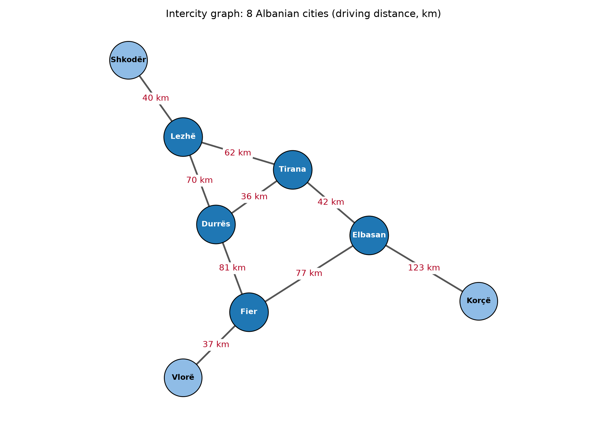
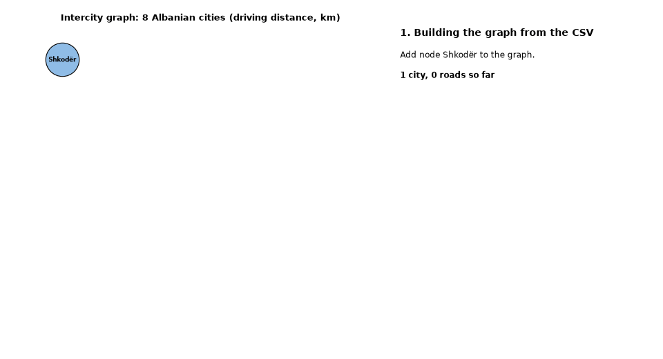
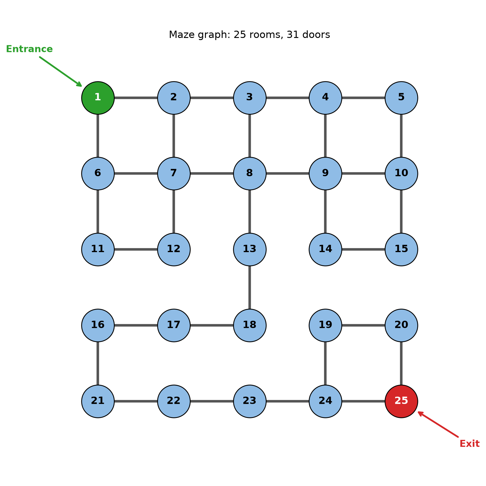
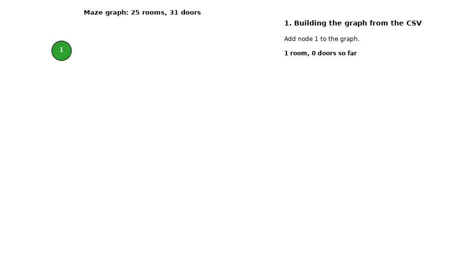

# AI_COURSE_UET

[](https://github.com/JonHHH09/AI_COURSE_UET/actions/workflows/ci.yml)

Seminar 2 exercises for the AI course (UET). Two graph problems, a shortest route between Albanian cities and a way out of a maze, solved with one small search module. The results are available as a terminal UI, command-line scripts, an MCP server and a live web viewer that animates each search.

## Seminar 2 at a glance

| | U1: cities | U2: maze |
|---|---|---|
| Data | `seminar2/dataset/cities.csv` | `maze_doors.csv`, `maze_config.csv` |
| Graph | 8 cities, 9 roads, weighted, undirected (km) | 25 rooms (5x5), 31 doors, unweighted, undirected |
| Question | Shortest route by total km | Path with the fewest doors, room 1 to room 25 |
| Algorithm | Dijkstra | BFS |
| Why | Roads have different lengths, so the nearest unsettled city is expanded first | Every door costs the same, so the first time BFS reaches a room is already the shortest way |
| Result | Shkodër → Lezhë → Tirana → Elbasan → Korçë, **267 km** | 1 → 2 → 3 → 8 → 13 → 18 → 17 → 16 → 21 → 22 → 23 → 24 → 25, **12 doors** |

| Cities graph | Route animation |
|---|---|
|  |  |

| Maze | Path animation |
|---|---|
|  |  |

## How it works

- The data lives in CSV files in `seminar2/dataset/`.
- The loaders (`seminar2/cities/graph.py`, `seminar2/maze/maze.py`) validate it and raise `ValueError` with the file and line number. They never return partial data.
- `seminar2/graph_search.py` holds `Graph` and the search algorithms. `dijkstra_steps` and `bfs_steps` are generators that yield one dict per step (frontier, visited, distances, predecessors). `dijkstra` and `bfs` just consume them, so a trace and a result cannot disagree.
- Dijkstra uses a priority queue ordered by distance. BFS uses a FIFO queue, and neighbours are sorted so the path is the same on every run.
- The consumers all read the same steps: the plain results, the MCP trace tools, the matplotlib animations and the live viewer.
- The written reasoning for each problem is in [`seminar2/cities/arsyetimi.md`](seminar2/cities/arsyetimi.md) and [`seminar2/maze/arsyetimi.md`](seminar2/maze/arsyetimi.md) (Albanian).

## Quick start

Requires Python 3.14+ and [uv](https://docs.astral.sh/uv/).

```
uv sync
uv run python -m seminar2.tui
```

## Terminal UI

A [Textual](https://textual.textualize.io/) app that works on Windows, Linux and macOS, and the mouse works too. The left side is the action list with a filter box, the right side is the options form, a Run button and the output, and the status bar shows the live viewer URL and any background processes. The default theme is `matrix` (green on black).

- `↑`/`↓` select an action
- `Enter` opens its form (runs at once if it has no options); `Enter` in a field runs
- `Tab` / `Shift+Tab` move between fields
- `Ctrl+R` runs from anywhere
- `Esc` cancels a running job, or goes back to the list
- `/` filters the list, `Ctrl+L` clears the output, `?` help (`F1` also works while typing in a field)
- `Ctrl+P` command palette (themes)
- `q` quits (not while typing in a field), `Ctrl+Q` / `Ctrl+C` quit anywhere

Background processes (the live viewer, for example) are stopped on exit.

## Command line

Run from the repo root, with `-m` for modules:

```
uv run python -m seminar2.cities.draw   # writes seminar2/images/cities/graph.png
uv run python -m seminar2.maze.draw     # writes seminar2/images/maze/maze.png
uv run python -m seminar2.cities.animate  # writes seminar2/images/cities/route.gif (--from, --to, --show, --out, --fps)
uv run python -m seminar2.maze.animate    # writes seminar2/images/maze/path.gif (--from, --to, --show, --out, --fps)
uv run python -m seminar2.live          # live viewer at http://127.0.0.1:8765 with demo searches
uv run python seminar2/mcp_server.py    # MCP server over stdio, plus the live viewer
uv run python -m seminar2.cities.graph  # print the city graph and checks
uv run python -m seminar2.maze.maze     # print the maze and validation result
```

`--show` opens a matplotlib window instead of saving a GIF.

## MCP server

Runs over stdio. The data is read once at startup, so restart the server after editing the CSVs.

| Tool | Problem | Purpose |
|---|---|---|
| `list_cities` | cities | Cities and how many roads each has |
| `get_roads(city)` | cities | Direct roads from a city, in km (name matching ignores case and accents) |
| `shortest_route(from_city, to_city)` | cities | Shortest route by total km (Dijkstra) |
| `trace_route(from_city, to_city, detail=False)` | cities | Same route plus a step-by-step explanation; `detail=True` returns the raw events |
| `get_maze` | maze | Entrance, exit, doors and each room's neighbours |
| `get_doors(room)` | maze | Rooms reachable through one room's doors |
| `find_path(from_room=1, to_room=25)` | maze | Fewest-doors path (BFS) |
| `trace_maze(from_room=1, to_room=25, detail=False)` | maze | Same path plus a step-by-step explanation; `detail=True` returns the raw events |
| `live_viewer()` | both | URL of the live viewer |

`shortest_route`, `find_path` and the trace tools also play their search in the live viewer at http://127.0.0.1:8765: first the graph is built edge by edge, then the search runs.

- Port: `SEMINAR2_LIVE_PORT` (default 8765). Off: `SEMINAR2_LIVE=0`.
- If the default port is busy, the viewer picks a free one (ask `live_viewer` for the URL). A busy port set through `SEMINAR2_LIVE_PORT` disables the viewer; the server keeps working.
- `uv run python -m seminar2.live --port N --no-browser` runs the viewer alone, without MCP.

## Use with Claude Code

The repo ships a project-scoped `.mcp.json`. Start `claude` in the repo root and it offers the `seminar2` server; approve it when prompted. Check it with `claude mcp list` or `/mcp` inside Claude Code. The tools appear as `mcp__seminar2__<tool>`, for example `mcp__seminar2__shortest_route`.

To add the server for every project instead:

```
claude mcp add --scope user seminar2 -- uv run --project /path/to/AI_COURSE_UET python /path/to/AI_COURSE_UET/seminar2/mcp_server.py
```

### Other clients

Generic MCP client config:

```json
{
  "mcpServers": {
    "seminar2": {
      "command": "uv",
      "args": ["run", "python", "seminar2/mcp_server.py"],
      "cwd": "/path/to/AI_COURSE_UET"
    }
  }
}
```

Hermes: set `mcp_servers.seminar2` in `~/.hermes/config.yaml` to run `uv run --quiet --project <repo> python <repo>/seminar2/mcp_server.py`, then check it with `hermes mcp test seminar2`.

## Development

```
uv run python -m unittest discover -s seminar2/tests -t .   # tests (stdlib unittest)
uvx ruff@0.17.3 check .                                     # lint, config in pyproject.toml
```

CI (GitHub Actions, `.github/workflows/ci.yml`) runs ruff and the tests on Ubuntu and Windows, on pushes to `main` and `development` and on pull requests.

Branches: work on a feature branch and open a PR into `development`. `development` goes to `main` through a release PR.
